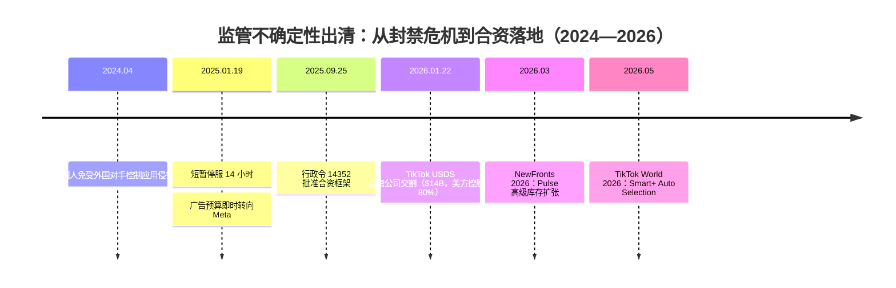
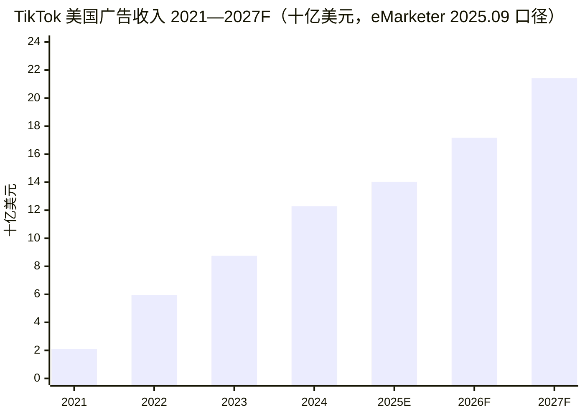
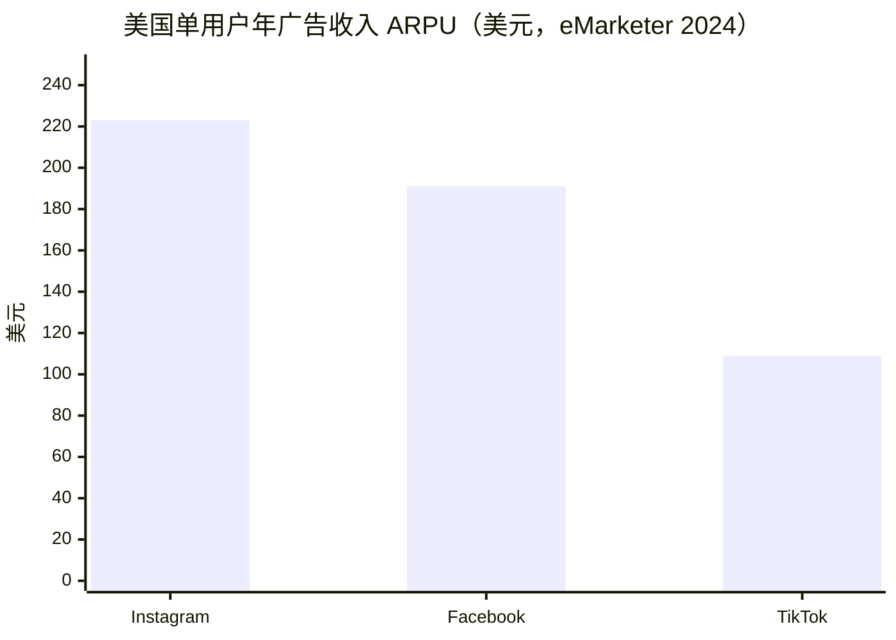
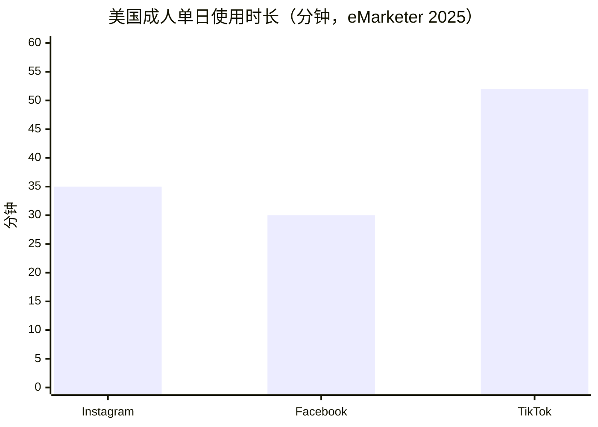
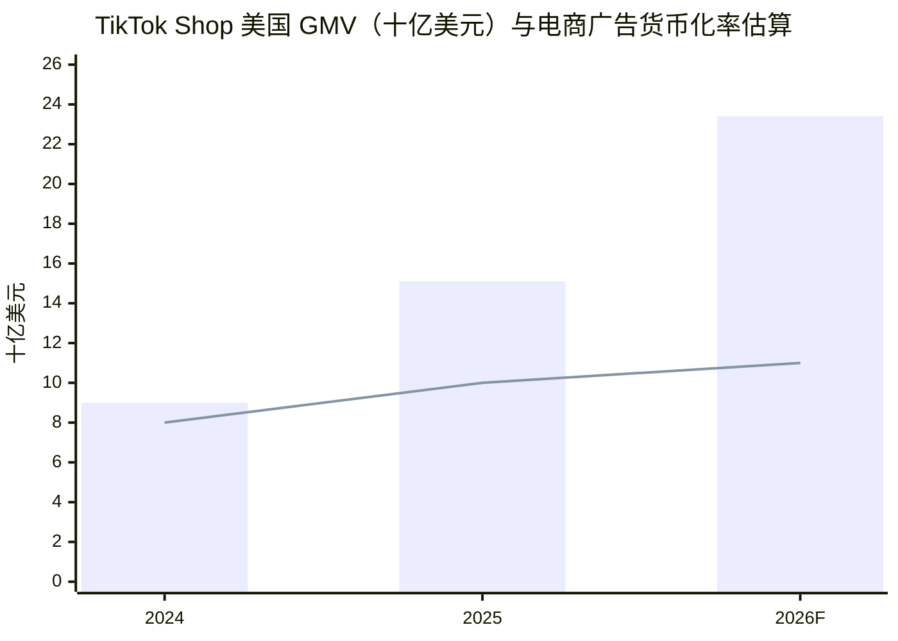
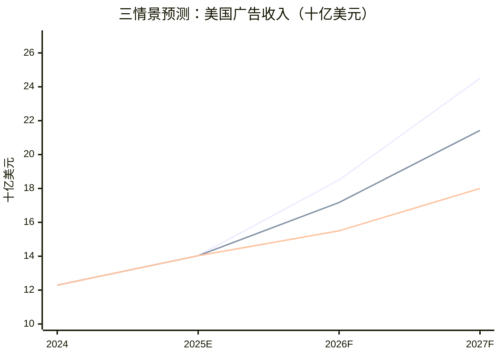

# TikTok 北美广告业务商业分析

**——品牌广告与效果广告双端视角下的增长空间与营收缺口测算（面试案例版）**

> 报告日期：2026 年 11 月 | 分析范围：TikTok 美国市场（北美主体）广告业务 | 数据口径：除注明外均为美元；实际值 A / 估算值 E / 预测值 F 三级标注，关键假设见附录 B
>
> 注：GitHub 版图表以 Mermaid 重绘；PNG 原图与 Word 正式版见本地交付目录。

---

## 0. 执行摘要

**总体判断：TikTok 美国广告业务正从“监管折价期”进入“确定性修复期”，2025 年是增速换挡的底部，2026—2027 年重新加速。**

- **事实（A/E）**：美国广告收入 2024 年约 \$12.29B，2025 年约 \$14.03B（+14.2%，增速较 2024 年的 +40.5% 大幅换挡），eMarketer 基准预测 2026 年 \$17.17B（+22.3%）、2027 年 \$21.43B（+24.8%）。2026 年 1 月 22 日 TikTok USDS 合资公司完成交割（交易规模 \$14B，Oracle/Silver Lake/MGX 各持 15%，字节跳动保留 19.9%），封禁风险正式出清。
- **核心发现一（变现效率缺口）**：TikTok 美国成人单日使用时长 52 分钟，比 Instagram（35 分钟）高 49%，但单用户年广告收入 ARPU 仅 \$109，为 Instagram（\$223）的 49%——**注意力份额与钱包份额严重错配，这是最大的结构性增长空间**，完全收敛的理论空间约 \$12.8B/年，现实路径下 2027 年可兑现约 \$2.5—3.5B（E）。
- **核心发现二（增长引擎切换）**：增长动力正从“信息流竞价库存扩张”切换为“电商闭环 + 自动化效果产品 + 搜索新场景”。TikTok Shop 美国 GMV 2025 年约 \$15.1B（+68%），2026 上半年已达 \$11.8B（+103%）；GMV Max 自 2025 年 7 月成为 Shop 广告唯一投放形态，电商广告已成为效果端第一增长曲线。
- **核心发现三（品牌端修复滞后）**：品牌广告（TopView/Pulse/挑战赛等预订制产品）受 2025 年监管不确定性冲击最大，Q4 2025 代理商普遍持观望态度；2026 年 NewFronts 上合资新管理层以 Pulse 高级库存扩张为主打，品牌预算回流是 2026—2027 年弹性最大、但也最不确定的变量。
- **战略建议（详见第 8 章）**：① 品牌端把“信任修复”产品化，用 Pulse 高级库存 + 度量确定性换回品牌预算；② 效果端以 GMV Max + Smart+ 吃掉电商与 SMB 广告预算，货币化率从约 10% 提至 12%（E）；③ 把度量基建（Events API / GA 集成 / Assisted Conversions）作为全业务的价格杠杆——被低估的转化找回来，eCPM 才有提价基础。

---

## 1. 研究边界与数据口径

| 维度 | 口径说明 |
| --- | --- |
| 分析对象 | TikTok 美国市场广告业务（北美收入主体；加拿大单列数据缺失，以美国近似北美） |
| 业务边界 | 品牌广告 + 效果广告双端；TikTok Shop 仅作为广告需求来源纳入，电商佣金收入不计入广告收入 |
| 时间范围 | 历史 2021—2025，预测 2026—2027 |
| 治理背景 | 2026.01.22 起美国业务由 TikTok USDS Joint Venture LLC 运营，本报告不区分交割前后主体，统一称“TikTok 美国” |
| 数据性质 | 字节跳动未上市、无分部审计披露；除标注 A 外，收入类数字均为第三方估算（E）或预测（F），主要来自 eMarketer、WARC、Momentum Works、IAB/PwC 及公司官方披露 |
| 重要限制 | eMarketer 与 WARC 对 2025 年美国广告收入的估计存在 \$2.2B 差异（\$14.03B vs \$11.8B），本报告以更新、口径更细的 eMarketer 2025 年 9 月预测为锚，差异在敏感性中体现 |

---

## 2. 业务概况：监管危机出清，广告基本盘完好

**分析目标：回答“业务现在处于什么状态，治理变化改变了什么”。**

### 2.1 关键事件线（2024—2026）



- 2024 年 4 月，美国国会通过“不剥离就禁售”法案；2025 年 1 月 19 日 TikTok 在美短暂停服约 14 小时。学术研究显示，停服当天广告主对 Meta 的投放需求显著上升（+5.4%），TikTok 侧投放在恢复后数日仍低于基线——**监管不确定性已被实证为可直接量化的收入冲击**（A，NIH/PMC 研究）。
- 2025 年 9 月 25 日行政令 14352 批准合资框架；2026 年 1 月 22 日交割：美方投资者合计控股约 80%，字节跳动保留 19.9%，Oracle 作为“可信安全伙伴”负责数据与算法安全审计，美国用户数据、内容审核与算法安全归 JV 管辖（A）。
- 交割后两个月，TikTok 即以“史上最强平台”姿态登上 2026 NewFronts，由 JV CEO Adam Presser 亲自站台招商，主打 Pulse 高级广告库存扩张（A）。

### 2.2 基本面在危机中保持韧性

- 用户侧：2026 年 1 月 TikTok 官方称美国用户超 2 亿（A，官方口径）；第三方口径 2024 年月活约 1.12 亿（E，eMarketer）。Pew 2025 年调查：37% 美国成人使用 TikTok，较 2021 年的 21% 显著提升（A）。
- 收入侧：2024 年美国广告收入 \$12.29B，约占其全球广告收入（\$26.42B）的 47%，是全球最大单一市场（E，eMarketer）。
- 隐忧：美国成人日均时长 2025 年 52 分钟，同比下滑 6.9%，eMarketer 预计 2026 年降至 50 分钟、2027 年 48 分钟（F）——**时长见顶回落意味着库存自然扩张结束，收入增长必须转向“单位时长变现效率”**。

### 2.3 本章回答

TikTok 美国广告业务处于“确定性修复期”起点：需求侧（用户、时长）基本盘完好但见顶，供给侧（治理、合规）最大风险已出清，收入侧 2025 年的增速换挡主要反映监管折价而非需求饱和。这决定了后文的分析重心：不是“要不要增长”，而是“增长从哪个产品、哪类广告主、哪个场景来”。

---

## 3. 市场与赛道：TAM/SAM/SOM

**分析目标：界定 TikTok 美国广告业务可竞争的盘子有多大、结构如何。**

### 3.1 市场规模（2025A，IAB/PwC）

```mermaid
xychart-beta
    title "美国数字广告分赛道收入 2025（十亿美元，IAB，口径存在交叉）"
    x-axis [社交, 搜索, 展示, 数字视频, 商业媒体]
    y-axis "十亿美元" 0 --> 130
    bar [117.7, 114.2, 81.6, 78.0, 63.4]
```

- **TAM**：美国数字广告总收入 \$294.6B（+13.9%）（A）。
- **SAM**：社交广告 \$117.7B（+32.6%，增速为各赛道之首）；相邻赛道数字视频 \$78.0B（+25.4%）、商业媒体 \$63.4B（+18.0%）与 TikTok 的短视频 + 电商闭环模式高度重叠（A）。
- **SOM**：TikTok 2025 年美国广告收入 \$14.03B，占社交广告盘子的 11.9%，占数字广告总盘子的 4.8%（E）。

### 3.2 结构判断（推断）

- 美国广告大盘的增长逻辑是“效果化 + 视频化 + 创作者化”：IAB 明确指出 2025 年增长集中于可直接衡量商业结果的渠道，创作者广告支出已达 \$37B 并预计 2026 年达 \$44B（A）——**这三条主线恰好是 TikTok 的产品基因所在，赛道顺风是真实的**。
- 但注意口径警示：IAB 按格式/渠道统计存在交叉（社交、视频、商业媒体互有重叠），TAM 加总会虚增，本报告仅以社交广告 \$117.7B 作为份额计算基准。

### 3.3 竞争位置

- 全球社交广告份额（2025Q2）：Meta 65.8%（\$46.56B）、YouTube 13.9%（\$9.8B）、TikTok 11.7%（\$8.25B，+40% YoY 为主要平台中最快）（E，公司财报 + 第三方估算）。
- Meta 2025 财年全球广告收入 \$196.18B（+22%）（A，10-K）；Instagram 美国 2025 年广告收入 \$32.03B（+24.4%），为 TikTok 美国体量的约 2.3 倍（E，eMarketer）。

---

## 4. 产品矩阵：品牌广告与效果广告双端梳理

**分析目标：用一张矩阵回答“TikTok 靠什么产品把北美注意力变成广告收入”。**

### 4.1 双端产品矩阵

| 端 | 产品 | 购买方式 | 价格水平（市场报价，E） | 角色定位 |
| --- | --- | --- | --- | --- |
| **品牌广告** | TopView（开屏首刷） | 预订制（managed） | CPM \$10–20，日最低 \$50K+ | 大曝光、新品发布、大促制高点 |
| | Brand Takeover | 预订制 | \$50K–150K/天 | 开屏强曝光（3–5 秒） |
| | Branded Hashtag Challenge | 预订制 | \$150K+/6 天 | UGC 共创、品牌事件 |
| | Branded Effects（AR 特效） | 预订制 | \$45K–200K | 互动品牌体验 |
| | Pulse / Pulse Premiere | 预订 + 竞价混合 | 溢价 CPM | 头部 4% 内容邻近位，2026 年扩张重点 |
| | Reach & Frequency | 预订制 | 门槛较低 | 品牌端自助化入口 |
| **效果广告** | In-Feed Ads（信息流竞价） | 竞价（自助） | CPM \$6–15 | 效果端基本盘 |
| | Spark Ads（原生内容加热） | 竞价 | CPM \$10+，\$500 起投 | 创作者内容商业化主力 |
| | Smart+（自动化效果套件） | 竞价 | — | 对标 Meta Advantage+；2025.10 统一为模块化自动化流程，2026.05 推出 Auto Selection |
| | GMV Max（电商闭环） | 竞价 | — | 2025.07 起为 TikTok Shop 唯一广告形态，直接优化店铺 ROI |
| | Search Ads（搜索广告） | 竞价 | — | 承接搜索意图，2026.10 并入 Smart+ |
| | 应用推广 / 线索收集 | 竞价 | — | 游戏、应用、本地服务赛道 |
| **度量与基建** | Pixel / Events API、Attribution Portfolio（GA 集成、Assisted Conversions）、Brand Lift Study、MMM | — | — | 双端共同的定价权基础 |
| **创意供给** | Symphony（生成式 AI 创意）、Creative Hub | — | — | 降低创意产能门槛，对标 Meta 生成式工具（400 万+ 广告主使用） |

### 4.2 矩阵的三个结构性特征（推断）

1. **效果端已完成“自动化对齐”**：Smart+（对标 Advantage+，后者年化消耗已超 \$60B）+ GMV Max（电商闭环）+ Search Ads 构成与 Meta/Google 对等的自动化效果产品栈，2025Q4—2026 年是产品成熟度拐点。
2. **品牌端的护城河是“独占注意力位”而非数据**：TopView/Takeover 卖的是开屏第一眼的确定性曝光，与效果端的算法逻辑完全不同，受监管情绪波动也最大。
3. **电商闭环是全矩阵的枢纽**：GMV Max 把“内容场（视频 50% GMV）—货架场（Shop Tab 51.4%，H1 2026）—直播场（8.2%）”三类流量统一为可竞价库存，这是 Meta 没有、Amazon 做不出内容侧的差异化结构。

---

## 5. 收入模型：总量锚定 + 双端拆分 + 驱动因子分解

**分析目标：搭一个可复算的收入模型，把 \$14.03B 拆到“品牌/效果 × 驱动因子”层面，让缺口可定位。**

### 5.1 总量锚（A/E/F）



| 年份 | 美国广告收入（\$B） | 同比 | 口径 |
| --- | --- | --- | --- |
| 2021 | 2.10 | — | E（Statista/eMarketer） |
| 2022 | 5.96 | +183.8% | E（eMarketer） |
| 2023 | 8.75 | +46.8% | E（eMarketer） |
| 2024 | 12.29 | +40.5% | E（eMarketer） |
| 2025 | 14.03 | +14.2% | E（eMarketer 2025.09 预测；WARC 口径 \$11.8B，作敏感性下限） |
| 2026F | 17.17 | +22.3% | F（eMarketer） |
| 2027F | 21.43 | +24.8% | F（eMarketer） |

**关键读数：2025 年的 +14.2% 是增长断层。** 同年美国社交广告大盘 +32.6%、Instagram 美国 +24.4%，TikTok 增速罕见跑输大盘——这是监管折价（1 月停服、全年五次延期、Q4 预算观望）的直接证据，而非竞争力恶化（推断，证据见 5.3 与 6.2）。

### 5.2 双端拆分（本报告估算，E）

| 端 | 2025 收入估算 | 占比 | 拆分依据 |
| --- | --- | --- | --- |
| 效果广告（竞价） | ≈ \$10.5B | ≈ 75% | 信息流竞价为库存主体；Smart+/GMV Max 自动化渗透快速提升；行业层面程序化购买 +20.5% vs 非程序化 -13.9%（IAB 2025A）佐证预算结构向效果迁移 |
| 品牌广告（预订制 + Pulse） | ≈ \$3.5B | ≈ 25% | TopView/Takeover/挑战赛为高价低量产品；Pulse 扩张中 |
| 合计 | \$14.03B | 100% | 锚定 eMarketer 总量 |

> 口径警示：TikTok 不披露品牌/效果收入拆分，75/25 为本报告基于产品结构与行业程序化趋势的估算（E），误差区间 ±10pct，结论对拆分比例不敏感（缺口分析以驱动因子为准）。

### 5.3 驱动因子模型

```
广告收入 = 有效广告库存 × 填充率 × eCPM
其中：有效广告库存 = MAU × 人均时长 × 广告加载率
```

| 驱动因子 | 2025 状态 | 方向 | 证据 |
| --- | --- | --- | --- |
| MAU | 约 1.12 亿（2024，E）；官方称美国用户超 2 亿（2026.01，A，口径偏宽） | 低速增长 | Pew：成人渗透率 37% 且趋稳 |
| 人均时长 | 52 分钟/天，同比 -6.9%（A，eMarketer） | **下滑**，2027F 48 分钟 | eMarketer；AI 内容应用（Sora/Vibes）分流风险 |
| 广告加载率 | 未披露 | 提升空间有限（用户体验约束） | 推断 |
| eCPM / 广告价格 | 竞价 CPM \$6–15（E） | **核心提升杠杆** | 度量改善（GA 集成试点：转化测量 +54%、CPA -27%，A，TikTok 披露）直接支撑提价 |
| 新场景库存 | Shop Tab、搜索、直播 | **结构性增量** | 美国用户 1/4 在打开 App 30 秒内发起搜索；2025 年电商意图搜索超 1000 亿次（A，TikTok 披露） |

**模型结论（推断）：时长下滑封顶了“库存量”逻辑，未来两年收入增量的约 75% 必须来自“eCPM 提升 + 新场景库存”**——这正是第 6 章缺口分析的方向。

---

## 6. 增长空间与营收缺口：三层测算

**分析目标：把“增长空间”从定性叙事变成三层可测算的缺口，并给出可兑现比例。**

### 6.1 缺口一：注意力变现效率缺口（结构性，最大）





- 事实（A/E）：TikTok 美国 ARPU \$109 vs Instagram \$223、Facebook \$191（eMarketer 2024）；时长 52 vs 35 分钟（2025）。
- 测算（E）：ARPU 每收敛 10 个百分点（约 \$11.4/用户/年，按 1.12 亿 MAU）≈ **+\$1.3B/年收入**。2027 年基准预测 \$21.43B 隐含 ARPU 约 \$160—170，即收敛了缺口的约 45%—50%，路径自洽。
- 机制解释（推断）：缺口来源不是广告卖不动，而是 ① 度量不完善导致转化价值被低估（Assisted Conversions 显示超 1/4 的 TikTok 归因转化发生在末次点击之外）；② 广告主结构偏 SMB 与新消费，大品牌预算占比低；③ 电商闭环 2023 年底才建成，转化信号积累远少于 Meta。

### 6.2 缺口二：监管折价缺口（事件性，正在修复）

- 事实（A）：2025.01.19 停服 14 小时，学术研究显示广告主对 Meta 需求即时 +5.4%、TikTok 投放恢复后数日仍低于基线；2025Q4 多家代理商公开表示因治理不明而暂缓 2026 年预算加码（Digiday）；2025 年收入增速 14.2%，跑输社交大盘 18.4 个百分点。
- 测算（E）：若 2025 年增速对齐 Instagram 水平（+24%），收入应约 \$15.2B，即**监管折价约 \$1.2—2.2B/年**。JV 交割 + 2026 NewFronts 管理层背书后，eMarketer 预测 2026 年增速回升至 +22.3%，即修复已被市场部分定价。

### 6.3 缺口三：新场景渗透缺口（场景性，期权价值）



- **电商广告**：TikTok Shop 美国 GMV 2024 \$9.0B → 2025 \$15.1B（+68%，Momentum Works，E）→ 2026H1 \$11.8B（+103%），eMarketer 预计 2026 年销售额口径 \$23.4B（F）。按商家广告支出占 GMV 约 8—11% 估算（E，参照成熟电商平台货币化率区间），电商闭环广告 2025 年贡献约 \$1.4B，2026 年可看至 \$2.3B+。
- **搜索广告**：2025 年美国电商意图搜索超 1000 亿次（A，TikTok 披露）；对照美国搜索广告大盘 \$114.2B（A，IAB），TikTok 搜索广告处于从零到一阶段，即便只做到社交搜索意图的个位数货币化，也是 \$1B 级期权（E）。
- **品牌高级库存**：Pulse 扩张 + CTV/大屏场景（对照 YouTube 已占美国电视观看时长 14.2%）是品牌端增量的期权，当前贡献尚小。

### 6.4 增长桥：缺口的兑现路径（2025→2027F，E）

| 分项 | 金额（\$B） | 说明 |
| --- | --- | --- |
| 2025 基线 | 14.03 | eMarketer |
| + 电商闭环广告（GMV Max） | +2.9 | GMV 扩张 × 货币化率提升 |
| + 监管折价修复（品牌预算回流） | +1.8 | 品牌端为主要受益方 |
| + 效果广告自动化（Smart+ 提效） | +1.6 | eCPM 与填充率改善 |
| + 搜索/新库存（Search/Pulse） | +1.3 | 新场景渗透 |
| − 时长下滑与转型摩擦 | -0.2 | 52→48 分钟 |
| **2027F** | **21.43** | eMarketer 基准预测 |

总量 \$14.03B → \$21.43B（+\$7.4B）锚定 eMarketer 基准预测；结构分解为本报告估算。**约 64% 的增量集中在“电商闭环 + 监管修复”两件事上**——这既是最大机会，也意味着预测对这两个假设高度敏感。

---

## 7. 三情景预测（2026—2027）

**分析目标：在明确假设下给出收入区间，而非单点数字。**



| 参数 | 保守 Bear | 基准 Base | 乐观 Bull |
| --- | --- | --- | --- |
| 2026 收入（\$B） | 15.5 | 17.17（eMarketer） | 18.5 |
| 2027 收入（\$B） | 18.0 | 21.43（eMarketer） | 24.5 |
| 监管修复 | 品牌预算回流缓慢，跨国广告主维持双平台备份 | 2026 上半年完成信心修复 | 修复 + 份额反超，抢走 Reels/Shorts 预算 |
| TikTok Shop 美国 GMV（2026） | \$20B | \$23.4B | \$26B+ |
| 电商广告货币化率 | 8% | 10% | 12% |
| 时长 | 加速下滑至 <48 分钟 | 缓降至 48—50 分钟 | 稳定在 50 分钟 |
| 隐含 ARPU（2027） | ≈ \$140 | ≈ \$165 | ≈ \$190（仍低于 Instagram 当前水平） |

**敏感性排序（推断）**：电商货币化率 ±1pct ≈ ±\$0.2B；监管修复节奏 ±半年 ≈ ∓\$0.8B；时长 ±2 分钟 ≈ ±\$0.5B。最大下行风险不是需求，而是 JV 治理执行（算法授权、数据隔离）若出技术或合规事故，品牌端会率先撤资。

---

## 8. 战略建议（问题—证据—措施—目标—风险）

### 建议一：品牌端——把“信任修复”做成可售卖的产品

| 项目 | 内容 |
| --- | --- |
| 发现的问题 | 品牌广告（约 \$3.5B，25%）是 2025 年受监管冲击最深的部分，且修复滞后于效果端 |
| 定量证据 | 2025Q4 代理商普遍暂缓 2026 预算（Digiday）；停服事件实证预算可即时迁移（NIH 研究）；品牌端修复贡献增长桥中 \$1.8B |
| 改善方案 | ① 以 Pulse/Pulse Premiere 扩张高级库存（2026 NewFronts 已启动）；② 用 JV 治理叙事 + 第三方度量认证（Brand Lift、MMM）打包“确定性”卖点；③ TopView 等大曝光产品绑定大促/新品日历做年度框架协议 |
| 量化目标 | 2027 年品牌广告收入 \$5.5—6.0B，占比稳定在 25—28%（E） |
| 实施风险 | 品牌预算决策周期长，若 2026 上半年出现治理负面舆情，回流推迟一年 |
| 监控指标 | 品牌广告主数量与续约率、Pulse 库存售罄率、Brand Lift 研究渗透率 |

### 建议二：效果端——以 GMV Max + Smart+ 吃掉电商与 SMB 预算

| 项目 | 内容 |
| --- | --- |
| 发现的问题 | 效果端增长依赖电商闭环单一引擎，货币化率与商家 ROI 证明仍是短板 |
| 定量证据 | Shop GMV +68%（2025）；年收 \$30M+ 品牌商家销售额 +97%；GMV Max 官方称早期测试 GMV +30%（厂商口径，未经独立验证）；对照 Meta Advantage+ 年化消耗 \$60B+ |
| 改善方案 | ① GMV Max 从“唯一选项”转向“默认 + 可控”，回应商家对黑盒的顾虑；② 用 Creative Hub 的创作者级数据把“达人—创意—GMV”归因做透；③ Smart+ 对非 Shop 效果赛道（游戏、应用、线索）复制自动化打法 |
| 量化目标 | 2027 年电商闭环广告收入 \$3.5B+，货币化率 12%（E）；效果端整体 eCPM 提升 15%+ |
| 实施风险 | 强制单一投放形态若损害中小商家 ROI，会引发预算回流 Meta；佣金 + 广告双重收费挤压商家利润 |
| 监控指标 | 商家广告支出/GMV、GMV Max 续投率、商家数（当前超半数店铺零销售，供给侧激活空间大） |

### 建议三：度量基建——全业务的定价权杠杆

| 项目 | 内容 |
| --- | --- |
| 发现的问题 | TikTok 的转化价值被系统性低估，直接压制 eCPM 与 ARPU 收敛速度 |
| 定量证据 | 超 1/4 TikTok 归因转化为“助攻转化”（末次点击之外）；GA 集成试点：测量到的转化 +54%、CPA -27%（A，TikTok 披露） |
| 改善方案 | ① Events API 渗透率作为效果端一级 KPI；② 把 Assisted Conversions 纳入默认报表而非可选视图；③ 对品牌端推 MMM/提升研究的标准化套餐 |
| 量化目标 | 12 个月内效果广告主 Events API 覆盖率 >70%，度量改善支撑 eCPM 提价 8—10%（E） |
| 实施风险 | 州隐私法与平台政策（ATT 类限制）持续侵蚀站外信号；度量口径激进化会遭第三方审计质疑 |
| 监控指标 | Events API 覆盖率、助攻转化占比、eCPM 同比 |

---

## 9. 结论

1. **TikTok 北美广告业务的核心矛盾不是需求，而是“注意力份额（时长第一）与钱包份额（ARPU 仅为 Instagram 一半）的错配”**——这是结构性、可修复的缺口。
2. 2025 年的增速断层（+14.2% vs 大盘 +32.6%）约 \$1.2—2.2B 是监管折价（E），随 2026 年 1 月 JV 交割已进入修复通道，2026F +22.3% 的预测即市场定价。
3. 未来两年 \$7.4B 增量的约 64% 取决于两件事：**电商闭环广告的货币化深化**（GMV Max × Shop GMV）与**品牌预算的确定性回流**（Pulse × 治理信任）。
4. 面试视角的一句话答案：*“TikTok 美国广告的问题不是增长故事讲完了，而是增长逻辑换了——从卖库存转向卖效率；谁能把度量做厚、把电商闭环做透、把品牌信任修回来，谁就能拿到这 \$7.4B 增量中的大头。”*

---

## 附录 A：数据来源登记（Source Register）

| # | 数据点 | 来源 | 类型 |
| --- | --- | --- | --- |
| 1 | 美国广告收入 2024 \$12.29B / 2025 \$14.03B / 2026F \$17.17B / 2027F \$21.43B；2024 全球 \$26.42B、美国占比 47% | eMarketer 2025.09 预测（经 Digiday 2025.10.20 引用）；eMarketer 图表 2025.09.01 | E/F |
| 2 | 2025 美国广告收入 \$11.8B、2026 \$13.4B；2025 全球 \$32.4B；美国占全球份额 43.3%(2022)→34.0%(2026)；81% 代理商计划增加 TikTok 投入 | WARC（经 MediaPost 2025.03.05、Search Engine Land 2025.03.07 引用） | F |
| 3 | 美国数字广告 2025 \$294.6B(+13.9%)、社交 \$117.7B(+32.6%)、数字视频 \$78B、商业媒体 \$63.4B、搜索 \$114.2B、创作者广告 \$37B | IAB/PwC Internet Advertising Revenue Report FY2025（2026.04 发布） | A |
| 4 | Instagram 美国 2025 \$32.03B(+24.4%)；ARPU：IG \$223 / FB \$191 / TikTok \$109；TikTok 美国月活 112.4M（2024） | eMarketer 新闻稿 2024.12.18 | E |
| 5 | 使用时长：TikTok 52 分钟（-6.9%）→50→48；IG 35、FB 30 分钟 | eMarketer（经 Digiday 2025.10.20 引用） | A/F |
| 6 | 美国成人 TikTok 渗透率 37%（2021: 21%）；YouTube 84%；青少年“几乎常在线” 21% | Pew Research Center 2025 调查 | A |
| 7 | TikTok Shop 美国 GMV：2024 \$9.0B、2025 \$15.1B(+68%)、2026H1 \$11.8B(+103%)、商城占比 51.4% | Momentum Works（经 digitalapplied 2026.10 汇编引用） | E |
| 8 | TikTok Shop 美国销售额 2025 \$15.82B(+108%)、占社交商务 18.2%；2026F \$23.41B；2028 超 \$30B | eMarketer 新闻稿 2025.12.09、FAQ 2026.08.27 | E/F |
| 9 | JV 交割：2026.01.22，\$14B，Oracle/Silver Lake/MGX 各 15%，字节 19.9%，既有投资人关联方 30.1%；JV CEO Adam Presser | POLITICO 2026.01.23；ABC News 2025.12.19；Barron's 2026.01.22 | A |
| 10 | 2026 NewFronts：Pulse 高级库存扩张、Khartoon Weiss 与 Adam Presser 站台 | Marketing Dive/Yahoo Finance 2026.03.25；MediaPost | A |
| 11 | Smart+ 统一自动化（2025.10 Advertising Week）、Auto Selection（2026.05 TikTok World）、GMV Max 为 Shop 唯一广告形态（2025.07 起）、Smart+ for Search（2026.10） | Influencer Marketing Hub 2025.10；mintec 2026.06；blckalpaca 2026.08；Common Thread 2026.10 | A/E |
| 12 | GA 集成试点：转化测量 +54%、CPA -27%；Assisted Conversions 占比 >25% | TikTok 官方披露（经 Influencer Marketing Hub 引用） | A（厂商口径） |
| 13 | Meta 2025 全球广告 \$196.18B(+22%，10-K)；2025Q2 社交广告份额 Meta 65.8%/YouTube 13.9%/TikTok 11.7%(\$8.25B,+40%)；Advantage+ 年化 \$60B+ | Meta FY2025 10-K（经 inbeat 汇编）；Sculpt 2025.08；mintec | A/E |
| 14 | 停服事件影响：Meta 广告需求 +5.4%，TikTok 投放恢复后仍低于基线 | Donati & Fong, PMC/NIH 2025.06 | A（学术研究） |
| 15 | 广告刊例价：TopView CPM \$10–20/日最低 \$50K+、Takeover \$50K–150K/天、挑战赛 \$150K+/6天、Branded Effects \$45K–200K、In-Feed CPM \$6–15、Spark \$10+ | stackmatix 2026.03、inBeat、Darkroom 2026.01、trendtrack 2026.06（代理商汇编） | E |
| 16 | 电商意图搜索 1000 亿+/年（美国，2025）；1/4 用户打开 30 秒内搜索；黑五网一 TikTok Shop 销售 \$500M+ | TikTok Newsroom（经 sqmagazine、digitalapplied 引用） | A（官方口径） |
| 17 | 字节跳动 2025 收入约 \$2000 亿（+29%）、估值约 \$5500 亿；2025 净利下滑超 70% | TechNode/Caixin（经 FourWeekMBA、skillademia 引用） | E |

## 附录 B：关键假设与计算说明

1. **双端拆分（75/25）**：TikTok 无官方拆分。依据：信息流竞价为库存主体、行业程序化趋势（IAB：程序化 +20.5% vs 非程序化 -13.9%）、预订制产品价高量小。敏感性：即使品牌端占比在 15—35% 区间变动，第 6 章缺口方向与建议优先级不变。
2. **电商广告货币化率（8—11%→12%）**：参照成熟电商平台商家广告支出占 GMV 比例区间设定；GMV Max 强制化使 TikTok 货币化率下限高于纯开放平台。
3. **监管折价（\$1.2—2.2B）**：以“若 2025 年增速对齐 Instagram（+24%）”为反事实基准，上限对齐社交大盘增速（+32.6%）。该测算为相关关系推断，非已证实因果。
4. **ARPU 收敛测算**：缺口 \$114/用户/年 × 1.12 亿 MAU ≈ \$12.8B 理论空间；每收敛 10pct ≈ \$1.3B。2027F \$21.43B 隐含 ARPU \$160—170（MAU 假设 1.25—1.35 亿），收敛约 45%—50%。
5. **增长桥分解**：总量锚定 eMarketer；分项为估算，各分项间存在交叉效应（如监管修复同时抬升品牌与效果端），分解仅表达主归因方向。
6. **口径冲突处理**：eMarketer（销售额口径）与 Momentum Works（GMV 口径）的 TikTok Shop 数字并列呈现、不混用；WARC 与 eMarketer 的广告收入差异以 eMarketer 为锚、WARC 为下限。

## 附录 C：事实 / 推断 / 预测分层声明

- **事实（A）**：JV 交割条款与时间、IAB/IAB-PwC 市场数据、Pew 渗透率、TikTok 官方披露（搜索量、黑五销售、产品发布时间与形态）、Meta 财报、停服事件学术测量。
- **估算（E）**：eMarketer/WARC/Momentum Works 的全部收入与 GMV 数字、双端 75/25 拆分、货币化率、监管折价金额、增长桥分项。
- **预测（F）**：2026—2027 三情景、品牌/效果端收入目标、货币化率目标。
- **待验证项**：TikTok 内部品牌/效果收入真实拆分、广告主数量与续约率、GMV Max 的真实增量 ROI（厂商 +30% 口径未经独立验证）——需内部数据方可闭合证据链。
